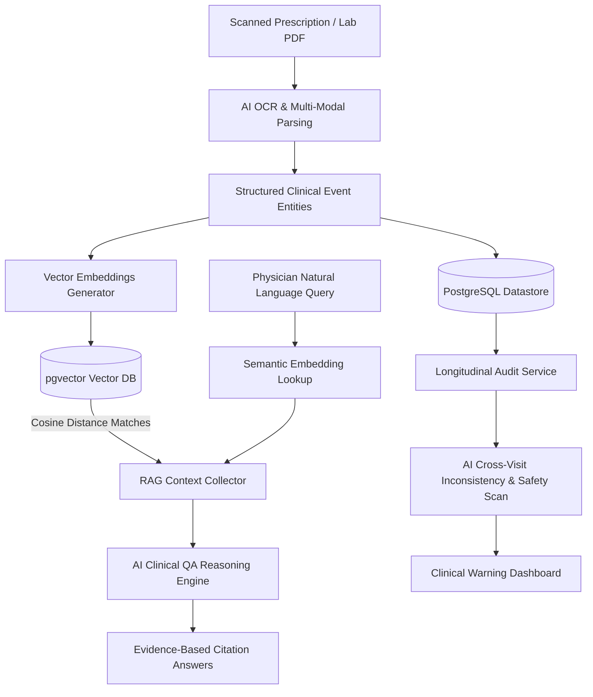

# AI Clinical Engine Architecture & Integration

This document outlines the system architecture, ingestion pipelines, semantic retrieval indexes, and longitudinal reasoning engines that power the MedAI Clinical Intelligence System.

---

## 🛠️ System Architecture Overview

MedAI integrates advanced Large Language Model (LLM) reasoning and vector search embeddings directly into a multi-tenant medical database to process, index, and audit unstructured medical records.



---

## 📊 Core AI Subsystems

### 1. Multi-Modal Data Ingestion & Structured Entity Parsing
*   **Pipeline Input**: Snapshot uploads of clinical documents (PNG, JPG, PDF).
*   **Processing Engine**:
    *   Digital PDF streams are parsed locally using an ES6-wrapped buffer stream.
    *   Image assets are passed directly to the vision completion models as base64 message packages.
*   **Structured Transformation**: The raw text/image payload is parsed under strict JSON schema constraints into a medical event entity containing:
    *   **Demographic Metadata**: Event date, clinic/hospital title, physician name.
    *   **Clinical Entities**: Diagnoses list, physical symptoms.
    *   **Medication Records**: Brand/generic names, precise dosages, frequencies, and duration parameters.
    *   **Lab Results**: Test titles, numeric values, and clinical measurement units.
*   **Dynamic Normalization Fallback**: Document categorization runs intelligent AI classifications, falling back to name regex matches if the model results are ambiguous.

### 2. Semantic Indexing & Vector Search (pgvector RAG)
*   **Embedding Space**: Generates high-dimension clinical vector embeddings (3072 dimensions) for extracted segments using specialized text embedding models.
*   **Vector Datastore**: Embeddings are mapped to records inside a PostgreSQL datastore using the `pgvector` index extension.
*   **Similarity Retrieval**: Natural language questions asked by the clinician are vectorized and queried against the database using cosine distance calculations:
    ```sql
    SELECT e.content_chunk, (e.embedding_vector <=> $1::vector) as distance
    FROM embeddings e
    JOIN documents d ON d.id = e.document_id
    WHERE d.patient_id = $2
    ORDER BY distance ASC
    LIMIT 5;
    ```
*   **Context-Bound Generation**: Matches are compiled into context segments and passed to the reasoning model to answer questions, citing evidence, safety tag ratings, and clinical notes.

### 3. Longitudinal Safety Auditing
*   **Reasoning Objective**: Scan a patient's historical medical record chronologically across multiple years and different hospitals to identify clinical safety warnings.
*   **Reasoning Scope**:
    *   **Medication Redundancies**: Flagging duplicate prescriptions or repeat active ingredients.
    *   **Dosage Modifications**: Identifying sudden or unexplained changes in medication quantities.
    *   **Diagnostic Contradictions**: Highlighting conflicting diagnoses or diagnostic shifts between visits.
    *   **Vital Signs Warning**: Analyzing parsed lab statistics to isolate dangerous trends (e.g. rising blood pressure).
*   **Security & Safety Boundaries**: The engine generates safety recommendations with clear disclaimers to ensure decisions are reviewed by a doctor before implementation.

---

## ⚙️ Model Routing Configuration

Model bindings are completely decoupled using environment variables, ensuring hot-swappable providers:
*   `AI_PROVIDER`: Binds the client runtime engine (`gemini` or `openai`).
*   `EXTRACT_MODEL_NAME`: Runs extraction tasks (`gemini-2.0-flash-lite` or `gpt-4o-mini`).
*   `EMBED_MODEL_NAME`: Maps text to vector space (`gemini-embedding-001` or `text-embedding-3-large`).
*   `REASON_MODEL_NAME`: Resolves longitudinal audits and QA RAG requests (`gemini-2.0-flash-lite` or `gpt-4o-mini`).
