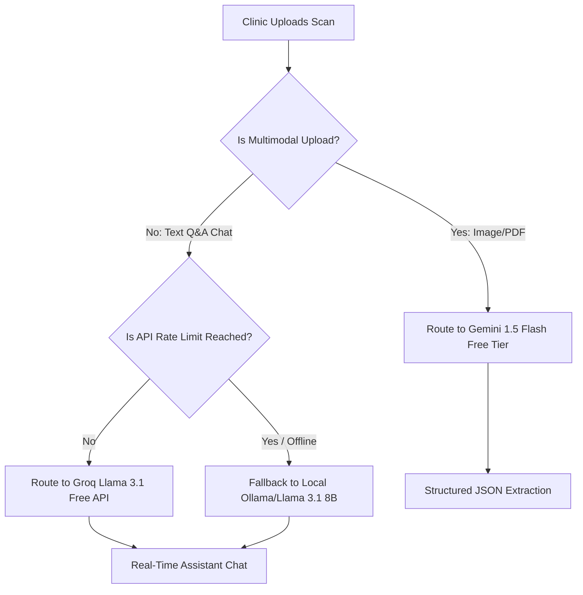

# Technical Evaluation: Zero-Cost and Highly Efficient AI Models for Clinical Intelligence Systems

This document provides a comparative analysis of zero-cost (completely free), highly efficient, and capable AI model options for deployment in our clinical records parsing and safety validation system.

---

## 1. Evaluation Criteria

To satisfy the requirements of clinical document parsing and real-time medical assistant Q&A, the selected AI models are evaluated against four key metrics:
1. **Cost (Zero-Cost Focus)**: Access to a robust free tier or the ability to host locally without licensing fees.
2. **Multimodal Capability**: Direct support for text extraction from images (prescriptions, charts) and documents (PDFs).
3. **Efficiency (Speed/Latency)**: Response time under 3–5 seconds to ensure seamless clinical workflow integration.
4. **Structured JSON Output Support**: Natively enforcing schema compliance (JSON mode) to guarantee database integrity.

---

## 2. AI Model Options Comparison

| Model Option | Provider / Architecture | Cost / Rate Limits | Multimodal Support | Strengths | Limitations |
| :--- | :--- | :--- | :--- | :--- | :--- |
| **Gemini 1.5 Flash** | Google AI Studio (Free Tier) | 15 RPM / 1,500 RPD (Completely Free) | Yes (Native PDF and Images) | Natively accepts long PDFs, extremely fast processing, excellent JSON output support. | Rate limits can be hit under heavy testing. |
| **Llama 3.1 (8B/70B)** | Groq Developer API (Free Tier) | Generous token-based free tier | No (Text Only) | Fastest inference speeds in the industry (~300 tokens/sec), excellent structured logic. | Requires local pre-processing of PDFs/images to text. |
| **Llama 3.1 / Qwen-2** | Local Self-Hosted (Ollama / vLLM) | 100% Free (Unlimited) | Yes (via Qwen2-VL or Llama 3.2 Vision) | Absolute data privacy (HIPAA compliant), zero external API dependencies, custom fine-tuning. | Requires GPU hardware (e.g., RTX 3090/4090) for high-performance inference. |
| **Hugging Face Serverless** | Hugging Face Hub (Free API) | Rate-limited free tier | Varies by hosted model | Access to thousands of open-source models with zero setup. | High cold-start latencies, rate limits, no SLA. |

---

## 3. Detailed Model Assessments

### Option A: Google Gemini 1.5 Flash (Google AI Studio Free Tier)
*   **Feasibility**: *Excellent (Currently Integrated)*
*   **Details**: Gemini 1.5 Flash is designed specifically for speed and multi-page document reasoning.
*   **Pros**:
    *   **Direct Document Parsing**: Can digest complex, 100-page scanned clinical records or large images directly in the prompt without a separate OCR/text-extraction pipeline.
    *   **Enforced JSON Outputs**: Highly reliable JSON schema enforcement.
    *   **Context Window**: 1,000,000 token limit allows long longitudinal charts to be evaluated in a single request.
*   **Cons**:
    *   Subject to rate limits on the free tier (15 requests per minute).

### Option B: Llama 3.1 8B/70B via Groq API (Free Developer Tier)
*   **Feasibility**: *Very High (for Q&A Chat & JSON Extraction)*
*   **Details**: Groq's custom LPU hardware delivers open-source model inference at speeds that feel instantaneous.
*   **Pros**:
    *   **Inference Speeds**: Lowers assistant reply latency to sub-second responses.
    *   **Zero Costs**: Free developer tier handles moderate clinic loads easily.
*   **Cons**:
    *   **No Native Vision/PDF Support**: To scan prescriptions or lab sheets, a local parser must first run OCR (e.g., Tesseract or PDF-to-Text), which increases local processing complexity.

### Option C: Local Self-Hosted Models (Ollama / vLLM)
*   **Feasibility**: *Recommended for Production / Privacy*
*   **Details**: Hosting models like **Llama 3.1 8B** or **Qwen 2 7B** locally using Ollama or vLLM.
*   **Pros**:
    *   **Absolute Data Privacy**: Patient records never leave the local clinic network, resolving data compliance challenges.
    *   **Zero Cost Boundaries**: No rate limits or external API down-times.
*   **Cons**:
    *   Requires dedicated on-premise hardware (a workstation with a modern Nvidia GPU) to run vision models efficiently.

---

## 4. Recommended Hybrid Architecture

To build a fully free, fast, and highly capable system, we recommend a **hybrid routing strategy**:

### Routing Policy:
1.  **For Scans & Vision (OCR)**: Route requests through the **Gemini 1.5 Flash Free Tier** to utilize its native PDF and vision features without building local vision pipelines.
2.  **For Text-only Q&A Assistant**: Route through the **Groq Llama 3.1 Free API** to achieve sub-second speeds.
3.  **Local Privacy / Offline Fallback**: Configure a local **Ollama** service running Llama 3.1 8B as an automatic fallback when rate limits are exceeded or internet connectivity is dropped.
